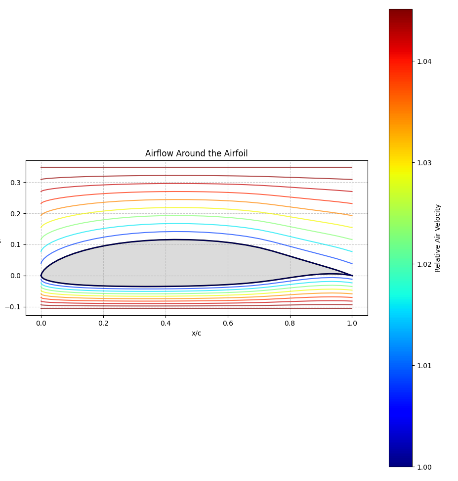
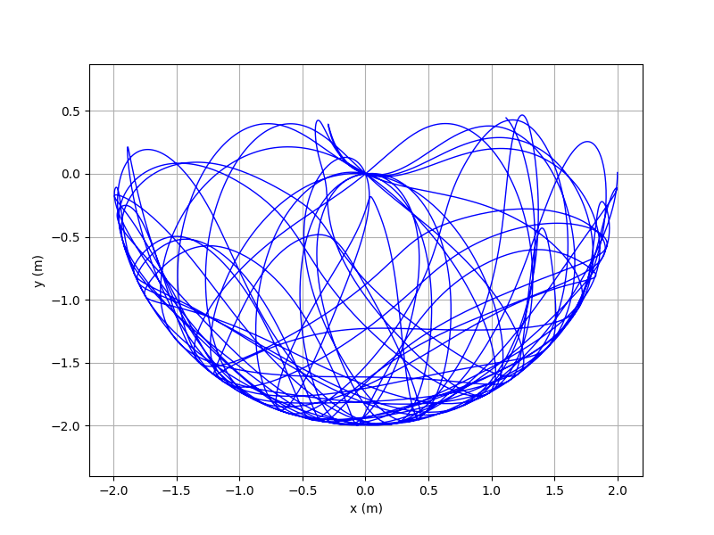

# Algorithmique numérique — ENSEIRB-MATMECA

Projets réalisés en équipe dans le cadre du module **IS104 (Algorithmique numérique)**, en 1re année à l'ENSEIRB-MATMECA (2024-2025).
Chaque projet implémente des méthodes numériques en Python, puis les applique à un problème concret.

| # | Projet | Méthodes | Application |
|---|--------|----------|-------------|
| 1 | [Précision et CORDIC](01-precision-cordic) | Arithmétique à précision finie, algorithmes CORDIC | Calcul de `ln`, `exp`, `arctan`, `tan` |
| 2 | [Systèmes linéaires](02-cholesky-equation-chaleur) | Cholesky (complète / incomplète), gradient conjugué préconditionné | Équation de la chaleur |
| 3 | [Compression d'image par SVD](03-svd-compression-image) | Householder, bidiagonalisation, QR, SVD | Compression d'image avec pertes |
| 4 | [Systèmes non linéaires](04-newton-raphson) | Newton-Raphson avec backtracking | Points de Lagrange, équilibre électrostatique |
| 5 | [Interpolation et intégration](05-splines-integration) | Splines cubiques, rectangles, trapèzes, Simpson | Profil d'une aile d'avion et portance |
| 6 | [Équations différentielles](06-equations-differentielles) | Euler, point milieu, Heun, Runge-Kutta 4 | Double pendule (chaos), modèle proie-prédateur |

Les projets 2, 4, 5 et 6 contiennent un rapport (`rapport.pdf`) qui présente la démarche et les résultats.

<p align="center">
  
  
</p>

## Installation

```bash
python3 -m venv .venv && source .venv/bin/activate
pip install -r requirements.txt
```

## Détail des projets

### 1. Précision et algorithmes CORDIC
Simulation d'une machine qui travaille avec `p` chiffres significatifs (`reduce`), puis étude des erreurs relatives sur l'addition et la multiplication. Calcul des fonctions `ln`, `exp`, `arctan` et `tan` par des méthodes de type CORDIC (comme dans une calculatrice). `projet1bis.py` est la version finale, avec l'analyse d'erreur.

```bash
cd 01-precision-cordic && python3 projet1bis.py
```

### 2. Résolution de systèmes linéaires — équation de la chaleur
Factorisation de Cholesky complète et incomplète, gradient conjugué avec ou sans préconditionnement, puis application à l'équation de la chaleur en 2D.

```bash
cd 02-cholesky-equation-chaleur && python3 test.py
```

### 3. Compression d'image par SVD
Transformations de Householder, mise sous forme bidiagonale, itérations QR pour obtenir la SVD, puis compression d'une image RGB par troncature des valeurs singulières.

```bash
cd 03-svd-compression-image/src && python3 bidiagonale.py
cd ../partie-4 && python3 traitement_image.py
```

### 4. Systèmes non linéaires — Newton-Raphson
Méthode de Newton-Raphson avec backtracking, appliquée au calcul des 5 points de Lagrange d'un système à deux corps et à l'équilibre électrostatique de `N` charges (lien avec les racines des polynômes de Legendre).

```bash
cd 04-newton-raphson && python3 lagrange.py && python3 EquilibreES.py
```

### 5. Interpolation et intégration — profil d'aile
Interpolation du profil d'une aile (données `e662.dat`) par splines cubiques, comparaison de la vitesse de convergence des méthodes d'intégration, puis calcul de la carte de pression et de la portance.

```bash
cd 05-splines-integration/src && python3 cl_airfoil_analysis.py e662.dat
```

### 6. Équations différentielles — systèmes dynamiques
Méthodes à un pas (Euler, point milieu, Heun, RK4) à pas fixe ou adaptatif. Étude du pendule simple, du comportement chaotique du double pendule, et des modèles de Malthus, Verhulst et Lotka-Volterra.

```bash
cd 06-equations-differentielles && python3 src/pendulum.py && python3 src/proie_predateur.py
```

## Auteurs

Projets réalisés en équipes de 3 ou 4 étudiants :

| Projet | Équipe |
|--------|--------|
| 1 | Yani Haouchine, Antoine Glasson, Benjamin Chew, Ihab Jaouad |
| 2 | Yani Haouchine, Arnaud Chane-Kive, Wissal Faouzi, Vivien Nebout |
| 3 | Yani Haouchine, Benjamin Chew, Tim Lacault |
| 4 | Yani Haouchine, Benjamin Basset, Margaux Lopez, Yoann Moresco |
| 5 | Yani Haouchine, Yoann Moresco, Wissal Faouzi, Solan Boher-Sanchez |
| 6 | Yani Haouchine, Benjamin Chew, Solan Boher-Sanchez, Alexis Gaudray Bouju |
